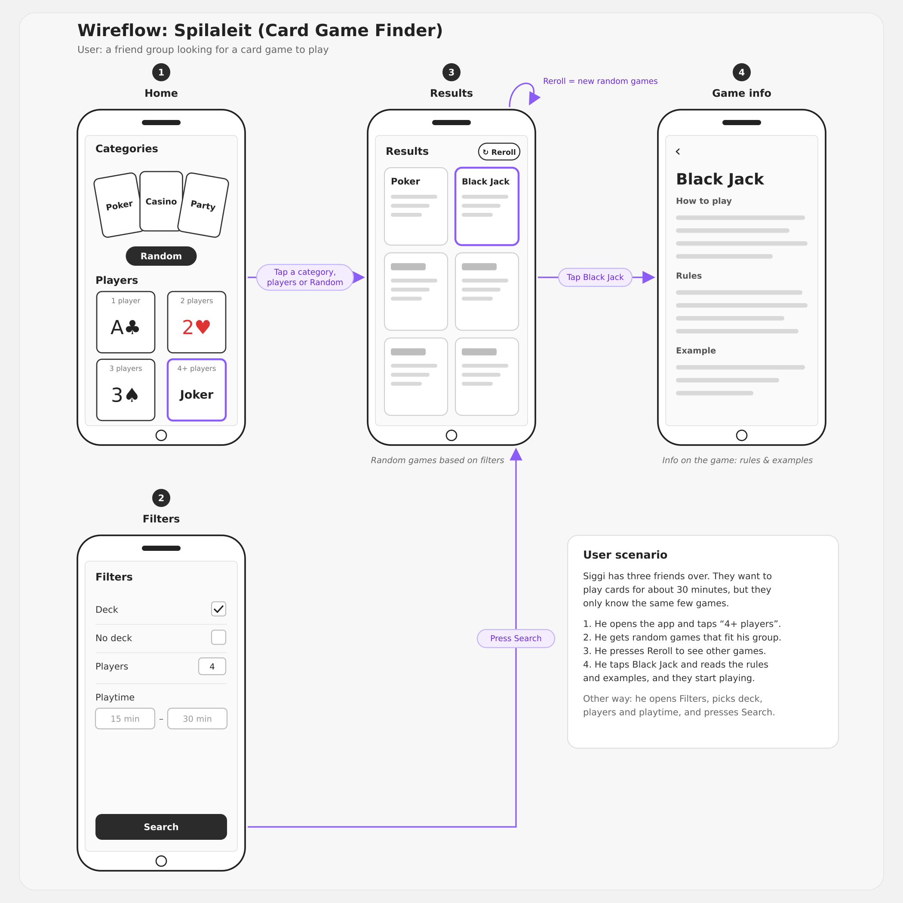
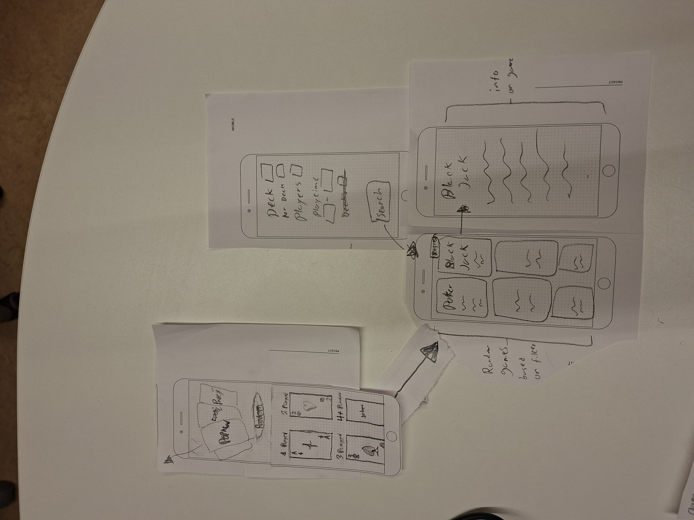

# VEF-3V-05DU-H-t_HopVerkefni

## Frame Work 
flask + python

### About
Our web app lets people search for and learn many different card games. You can filter or search for exactly what you want. For example, if there are four of you, filter for 4 players; if you want to play for 30 minutes, filter for 30 minutes. You can also choose how many games the site shows you. When you press Search, you get a list of games that suit your group. Pick the game you want to play, and the app shows you how to play it, with all the rules and examples.

The problem we want to solve is that most people only know a few games and end up playing the same games over and over again, people also often disagree about the rules in the middle of a game. Our app puts everything in one place. You can search and filter games and find hundreds of games suitable for your group, with clear step by step examples and rules

### user stories:

**Beginner**
1. As a beginner, I want to read step-by-step rules with examples so that I can learn a new game like Go Fish or Solitaire without anyone teaching me.

**Parent / family**
2. As a parent, I want to filter games by age and number of players so that I can find a game the whole family can play together.

**Friend group**
3. As someone hanging out with friends, I want to filter by number of players and play time so that we can quickly find a game that fits our group and the time we have.

**Experienced player**
4. As an experienced player, I want to see games similar to the ones I already like so that I can find new games I'll enjoy.
5. As an experienced player, I want to browse games by category so that I can find the type of game I'm in the mood for.

**Rule checker**
6. As a player in the middle of a game, I want to quickly look up a specific rule so that we can settle arguments, like whether my sister cheated in Ólsen ólsen.

### Wireframe

### Mockup
#### Heima Síða
https://www.figma.com/make/DA2NwnzaA0WOoVwDhvay0K/Card-Game-Finder-Homepage?t=sB5StYNy4v2nHYLh-1

