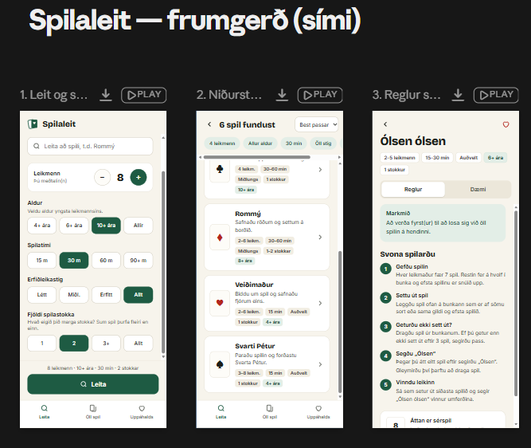

# VEF-3V-05DU-H-t_HopVerkefni

## libraries we MIGHT use
flask + python
| Node.js + Express + SQLite

### About
Our web app lets people search for and learn many different card games. You can filter or search for exactly what you want. For example, if there are four of you, filter for 4 players; if you want to play for 30 minutes, filter for 30 minutes. You can also choose how many games the site shows you. When you press Search, you get a list of games that suit your group. Pick the game you want to play, and the app shows you how to play it, with all the rules and examples.

### user stories:

1. I am a user who wants to learn how to play Go Fish
2. I am a user who wants to learn how to play Solitaire
3. I am a user who wants to find out if my sister cheated in Ólsen Ólsen
4. I am a user who wants to find what card games I can play with my family
5. I am a user who wants to find what card games I can play with my friends
6. I am a user who wants to know what card games are similar to the one's I like
7. I am a admin who wants to see the user experience to improve the website
8. I am a user who wants to organize the card games in categories so I can find them easier

### Mockup

